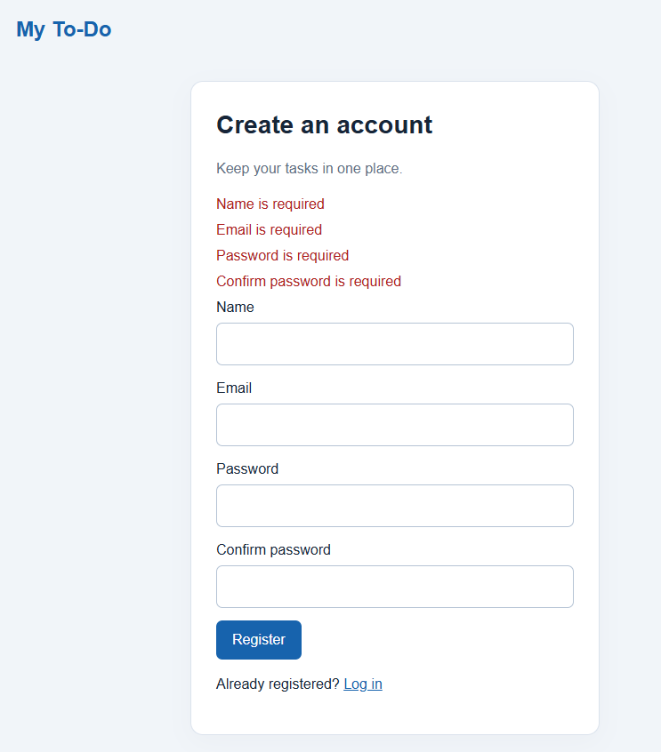
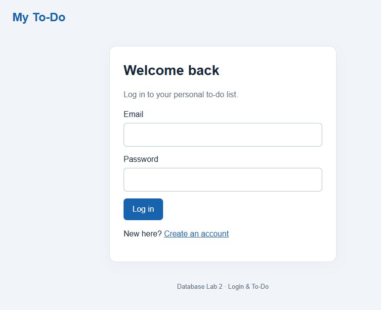
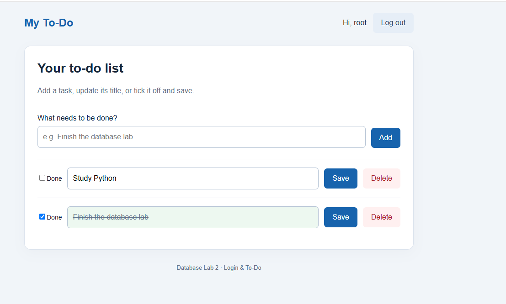
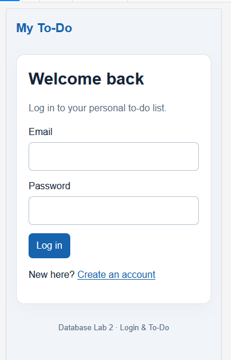

# Database Lab 2: Login & To-Do Application

## Student information 
- Student name: Mohamed Nader Kamal Elashry
- Student ID: 2304082
- Contributions: I worked alone and completed all parts of the project.


## Technologies
Python / Flask, PyMySQL (plain SQL, no ORM), bcrypt, Flask-Session (server-side sessions), HTML, CSS, JavaScript, and MySQL 8.0. MySQL Workbench runs the database script; Python runs the website.

## Windows setup, step by step
1. Install Python 3 with pip, MySQL Server 8.0 and MySQL Workbench. Ensure the MySQL80 service is running. Open the extracted project folder in VS Code.
2. Open Workbench and connect to localhost:3306 using your MySQL username and password.
3. Select **File > Open SQL Script**, open `database/schema.sql`, and click the lightning bolt to execute the whole script. **This script drops and recreates registration: rerunning it deletes its existing data.** Refresh SCHEMAS; expand registration > Tables. You should see users and todos. The submitted script contains DDL only, no sample data.
4. In a Windows Command Prompt inside this project folder, run:
   ```bat
   py -3.13 -m venv .venv
   .venv\Scripts\activate
   python -m pip install -r requirements.txt
   copy .env.example .env
   python -c "import secrets; print(secrets.token_hex(32))"
   ```
5. Edit `.env`: enter your own MySQL password in DB_PASSWORD and paste the generated random value into SECRET_KEY. Keep DB_NAME=registration and DB_PORT=3306. Quote a password containing `#` in the .env file. Never commit .env.
6. Start the website:
   ```bat
   python app.py
   ```
7. Open http://127.0.0.1:5000/register in your browser. Register an account, then add tasks. Workbench is used to inspect the tables, while the browser is used to register, log in and manage tasks.
8. Stop the server with Ctrl+C. For a later run, activate the virtual environment and run `python app.py` again. For macOS/Linux, use `python3 -m venv .venv`, `source .venv/bin/activate` and `cp .env.example .env`.

## Features R1-R10
- R1: Registration, duplicate-email feedback and automatic login.
- R2: Login with one common error for unknown emails and wrong passwords; logout destroys the session.
- R3: Private to-do list, belonging to the session user, newest first.
- R4-R7: Add, edit, save done/open status, and delete after confirmation.
- R8: Browser and server validation with the required exact messages. Invalid submitted fields do not trigger database writes. The existing list is read to redisplay an invalid add/edit form.
- R9: bcrypt password hashes, parameterized SQL, ownership checks on every UPDATE/DELETE, and user_id only from the server-side session.
- R10: Consistent responsive styling, visible errors, done styling, name/logout, and an empty-list message.
- Extra protection: CSRF tokens. Passwords have a 72-byte limit because bcrypt has that limit; matching feedback is provided in the browser and server.

## Required screenshots (capture your own running project)
Put these four images in screenshots/ before submission;
1. Register page after submitting an empty form, showing all four messages.
2. Login page.
3. Your to-do list with several tasks, including one ticked and saved as done.
4. The site at 360 px width (browser developer tools > responsive/device mode).

After capturing them, these links will display the images on GitHub:






## Written answers
**(a) Why AND user_id = ? in UPDATE and DELETE?**
The to-do number comes from the browser and can be changed. The condition allows changes only to a to-do owned by the logged-in user. Removing it lets a user edit or delete another user's task if they know its number. In PyMySQL the placeholder is %s instead of ?.

**(b) What if the user_id does not exist?**
MySQL rejects the INSERT (usually error 1452) because todos.user_id references users.user_id. This is the foreign-key constraint enforcing referential integrity.

**(c) Why a hash instead of the password?**
A database leak should not expose the original passwords. bcrypt stores a salted, slow hash; login checks the supplied password against it. The original password is not stored, and identical passwords produce different hashes.

**(d) Why check an empty name if it is NOT NULL?**
An empty string is a value, not SQL NULL. NOT NULL still accepts it. The application strips spaces and rejects an empty name.

## Manual checks
- Without login, /todos redirects to /login.
- Empty registration: four required messages in the browser. Disable JavaScript and repeat to test server validation.
- Duplicate email: Email Already Exists.
- Wrong password and unknown email: Invalid email or password.
- Enter `' OR '1'='1' --` as login email: no login.
- Create two users in separate browser profiles: each sees only their tasks. Submit a save/delete POST for the other user's task ID using your own CSRF token: the other task stays unchanged.
- Add/edit an all-space title and a 201-character title: Title is required / Title is too long.
- Cancel Delete: the task remains. Confirm Delete: it disappears.
- In Workbench run `USE registration; SELECT * FROM users; SELECT * FROM todos;`. Passwords should look like `$2b$12$...`, never readable passwords.
- Try an INSERT with a non-existent user_id in Workbench: foreign-key error.

## GitHub submission
Create your own GitHub repository, then run from this folder:
```bat
git init
git add .
git commit -m "Build login and personal to-do application"
git branch -M main
git remote add origin https://github.com/YOUR_USERNAME/YOUR_REPOSITORY.git
git push -u origin main
```
Make small genuine commits as you work. A private repository must be shared with the TAs using the usernames they provide. Complete student information and add screenshots before submitting the repository URL. Understand and personalize the code so you can explain it during assessment.

## Verification note
The application was connected successfully to MySQL on Windows using Python 3.13. Registration, adding tasks, and saving a task as completed were verified.
